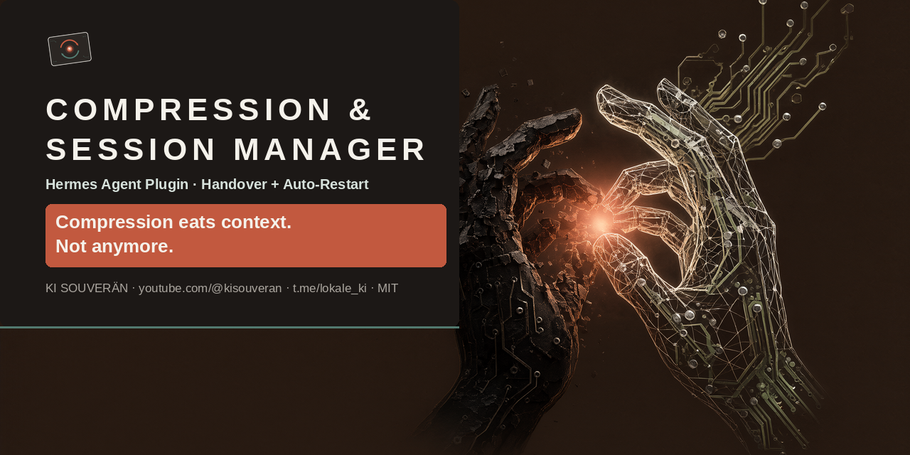

**English** | [Deutsch](README.de.md)

<p align="center"></p>

# Compression- and Session Manager

A Hermes plugin plus a relay service against forgetting during context compression (`compression-session-manager`).

Long agent sessions eventually get compressed. Whatever drops out is gone, and after several compressions the agent
works noticeably worse. This package enforces one simple rule and keeps the agent working through it, even when you
are away from the keyboard:

1. **A handoff protocol before every compression.** At 82 % of the compression threshold the agent gets a notice on
   the next tool result: finish the current step, write a protocol (task, decisions, state, open defects, running
   processes, next steps, opening sentence), then keep working.
2. **After the 2nd compression the session is exhausted.** The agent finishes the step cleanly, starts nothing new
   and writes a final protocol (`…_Abschluss.md`).
3. **Relay (Staffel):** if the relay service (`staffel.py`) is running, it then automatically opens a follow-up
   session “<Title> · Teil 2” and hands it the protocol. The work continues without a click. Without the service you
   get the opening sentence and open the new session yourself (`/new` is a desktop-app command; the server cannot
   trigger it).

```
context 82 % ─► notice ─► handoff protocol K1 ─► compression 1
context 82 % ─► notice ─► handoff protocol K2 ─► compression 2
next tool ─► “exhausted” ─► final protocol ─► turn ends ─► request ─► staffel.py ─► “· Teil 2” keeps working
```

The notice is attached to the tool result (`transform_tool_result`), so it also arrives mid-turn during long turns.
The plugin reads the threshold from the session’s compressor, so it fits any model and any context size. Errors in
the plugin leave everything unchanged (fail-open).

## Components

| File | Role |
|---|---|
| `compression-session-manager/__init__.py` | Plugin (hooks `post_api_request`, `transform_tool_result`, `on_session_end`) |
| `compression-session-manager/staffel.py` | Relay service: holds a connection to `hermes serve`, starts follow-up sessions |
| `compression-session-manager/csm-staffel.service` | systemd user service for `staffel.py` |
| `tests/test_plugin.py` | Offline test of the plugin logic without Hermes |

## Installation

```bash
cp -r compression-session-manager ~/.hermes/plugins/
cp ~/.hermes/plugins/compression-session-manager/csm-staffel.service ~/.config/systemd/user/
# in the .service file, point ExecStart at Hermes’s Python (needs websockets + yaml)
systemctl --user daemon-reload && systemctl --user enable --now csm-staffel.service
```

In `~/.hermes/config.yaml` (the config keys are German, matching the code):

```yaml
plugins:
  enabled:
    - compression-session-manager
  entries:
    compression-session-manager:
      ordner: ~/.hermes/uebergabe     # the agent writes the protocols here
      anteil: 0.82                    # notice at 82 % of the compression threshold
      erschoepft_ab: 2                # session is exhausted after this many compressions
      ohne_plattformen: [cron]        # skip cron runs
      melden: true
      melde_befehl: ""                # optional: a script that receives one text line (e.g. a Telegram notice)
      staffel: true                   # follow-up sessions via staffel.py
      staffel_max_pro_tag: 3          # at most this many relays per origin session per day
      brueckenziel_datei: ""          # optional: a file holding a session ID that should travel along
      deckel_warnung: true            # warn once per session when threshold_tokens caps a large window
      prune_anteil: 0                 # >0: prune local models from this share of the threshold, cloud APIs never
```

### Local and 1M-context API models side by side

The plugin follows Hermes’s own compression threshold. Hermes computes it as `context window × compression.threshold`,
capped by `compression.threshold_tokens`. That cap is **global**: a `threshold_tokens: 110000` meant for a local
131K model also caps a 1M-context API model at 110K, so the session gets compressed twice and relayed long before its
window is anywhere near full. Use the ratio only and drop the cap:

```yaml
compression:
  threshold: 0.84          # 131K local → 110,100 · 1M API model → ~880K
  threshold_tokens: null   # no absolute cap
```

Hermes reads this for every new session, no restart needed. Per-model ratios go in `compression.model_thresholds`
(Hermes raises anything below 75 % on windows under 512K). With `deckel_warnung` the plugin logs a warning (and
reports via `melde_befehl`) once per session when the cap sets a threshold below half the window.

**Prune local, not in the cloud.** `compression.proactive_prune_tokens` (dropping old tool results without an LLM) is
global too. Every prune breaks the prompt cache: on a local model that is free and saves compressions, on a cloud API
it costs money. Set it to `0` globally and let the plugin decide per session with `prune_anteil: 0.86`: if the
model’s endpoint is local (loopback, private network, `localhost`, `*.local`), the prune trigger becomes 86 % of that
session’s compression threshold (131K local → ~94,700); for any other endpoint it stays off. It is re-evaluated on
every API call, so a model switch follows along, and the first decision per session is logged
(`proactive_prune_tokens für <id> = … (lokal|Cloud, <base_url>)`). If the plugin is not loaded, nothing prunes
(fail-safe for cost). Like the notices, this covers sessions inside `hermes serve` (desktop sessions and the kanban
workers it dispatches); a standalone `hermes` CLI process keeps the global value.

Then restart `hermes serve` (plugins load only at start), and do it when no session is working. A restart aborts
running turns. Check: `hermes plugins list | grep compression`, `systemctl --user status csm-staffel`.

## Safeguards

- The relay service starts only on a request from the plugin, and only after a **cleanly finished** turn (not after
  an abort or error).
- **No relay without a final protocol:** the service looks for a `*_Abschluss.md` that is newer than “exhausted” and
  larger than 200 bytes. After 15 minutes with no protocol it reports back and gives up.
- **Daily limit** per origin session (default 3), so nothing runs endlessly. With a paid API model, every relay costs
  real money.
- The service never revives closed sessions.
- The plugin detects whether the service is running via a heartbeat (`<relay_folder>/herzschlag`). The notice to the
  agent adapts accordingly (“starts automatically” or “you open it yourself”).

## Testing without 90,000 tokens

Create `~/.hermes/cache/compression_session_manager_test.json`, e.g.
`{"sitzungen": ["<session_id>"], "anteil": 0.05, "zaehler_plus": 2}`. Then 5 % counts as the threshold for the named
sessions only, and `zaehler_plus` simulates compressions (2 = “exhausted”). `python tests/test_plugin.py` checks the
logic entirely without Hermes. Delete the test file afterwards.

## Field-tested

On 2026-10-20 in Hermes Desktop (`hermes serve`) with a local model:
- The notice before the 1st compression and “session exhausted” arrived and were followed, as was the Telegram notice.
- End-to-end: exhausted test session → final protocol → follow-up session “· Teil 2” started without a click, read the
  protocol and worked the next step. The service survived a `serve` restart in between.

## Limits

- A turn with no tool calls at all gets the notice only at the next tool call.
- How good the protocol turns out depends on the model.
- The plugin reads the compressor via `tui_gateway.server._sessions` (Hermes Desktop/serve). On other frontends it
  finds no session and does nothing.
- A session held only by the service does not continue automatically after a `serve` restart. It stays saved and can
  be opened in the app.

## KI SOUVERÄN

Local, sovereign AI — videos, code, and an open diary. Each channel points to the other two.

- 🎥 **YouTube:** [@kisouveran](https://youtube.com/@kisouveran) — videos & reach
- 💻 **GitHub:** [github.com/wolffahrer](https://github.com/wolffahrer) — the code behind it
- 💬 **Telegram:** [t.me/lokale_ki](https://t.me/lokale_ki) — the diary of Vik & Besen

License: MIT
